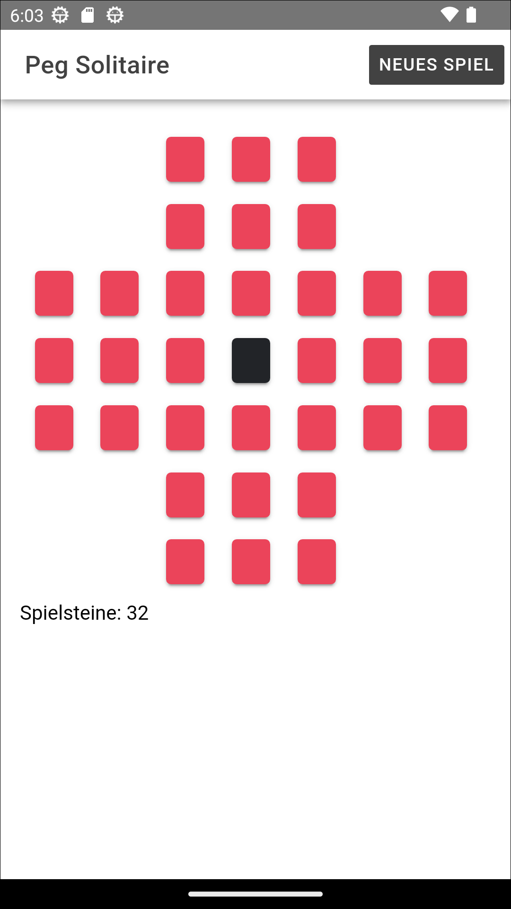
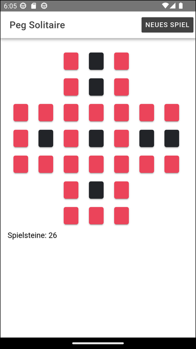
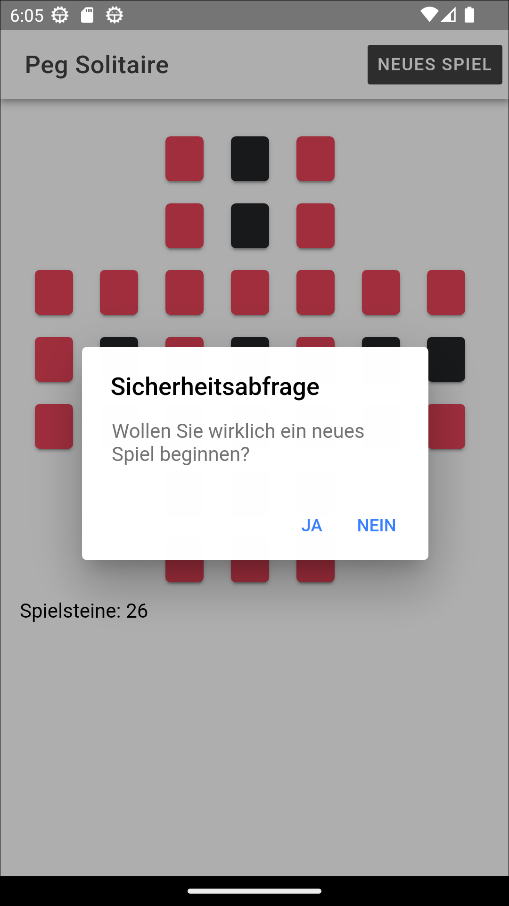

# Spiel "Peg Solitaire" mit Ionic #

 

Dieses Repository enthält eine einfache Implementierung des Brettspiels [Peg Solitaire](https://de.wikipedia.org/wiki/Solit%C3%A4r_(Brettspiel))
mit Ionic/Angular.

 

Siehe [dieses Repository](https://github.com/MDecker-MobileComputing/Android_PegSolitaire) für eine Implementierung des Spiels als native Android-App mit Java.

 

Anleitung, wie man das Spiel löst: [siehe hier (auf Englisch)](https://www.wikihow.com/Win-the-Peg-Solitaire-Game-(English-Board))

 

----

## License ##

 

  &nbsp; 

 

----

## License ##

 

See the [LICENSE file](LICENSE.md) for license rights and limitations (BSD 3-Clause License) for the files in this repository.

 
